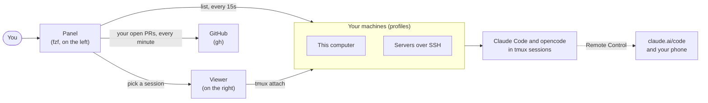

<div align="center">

<pre>
      ██          ██████████  ████████        ██
      ██                ██    ██      ██    ████
      ██              ██      ████████        ██
      ██            ██        ██    ██        ██
      ██████████  ██████████  ██      ██    ██████

████████      ██████    ██      ██  ██████████  ██
██      ██  ██      ██  ████    ██  ██          ██
████████    ██████████  ██  ██  ██  ████████    ██
██          ██      ██  ██    ████  ██          ██
██          ██      ██  ██      ██  ██████████  ██████████
</pre>

**Every Claude Code and opencode session you run, on every machine you own, in one clickable list.**<br>
**Your pull requests right under them.**


[Quick start](#-quick-start) ·
[What you get](#-what-you-get) ·
[Using it](#-using-it) ·
[Profiles](#-profiles) ·
[Settings](#-settings) ·
[Something wrong?](#-something-wrong)

</div>

```
 lzr1 ───────────────────────────────────────────────
 3 sessions · 1▶ 1⧗ 1· · 1✱
 oracle-sessions ssh · online · 2 ───────────────────
 ▌ ▶ lerian-clients                     opus · 12m ●
 ▌   Docker dev data export and import
 ▌   ⎇ feat/docker-dev-data +3 · lerian-clients
   · erebor                            sonnet · 2h
     Review the tmux layer
     ⎇ main · erebor
 macbook-pro-sessions local · online · 1 ────────────
   ⧗ ✱ midaz                             opus · 4m
     ⧗ Do you want to run make test?
     ⎇ feat/fees +7 · midaz


 pull requests victorlazari · gh · 2 ────────────────
   ⧗ #906 fix(oncall): guard ownerless VoIP pro… 2h
     lerian-clients · ⎇ fix/voip-owner · review req…
   ✓ #1398 chore: bump lib-commons               3d
     midaz · ⎇ chore/lib-commons · checks passed
 ────────────────────────────────────────────────────
 [+opus] [+sonnet] [+opencode] [web] [↻] [?]
```

<p align="center"><sub>The panel, on the left of your terminal. Pick a session and the viewer, on the right, shows it live.</sub></p>

---

## 🚀 Quick start

```sh
git clone https://github.com/victorlazari/lzr1-panel.git ~/Github/lazari/lzr1-panel
cd ~/Github/lazari/lzr1-panel
./install.sh
```

Then open a new terminal and run:

```sh
lzr1-panel open
```

That's it. The installer sets everything up and checks it at the end.
If anything is off, `lzr1-panel doctor` tells you what is wrong and how to fix it.

---

## ✨ What you get

| | |
|---|---|
| 🖥 **All your machines** | This computer and any server over SSH, each one a *profile*. A machine that does not answer is left out until it does. |
| 📋 **Every session, at a glance** | Three lines each: its state (`▶` working, `⧗` waiting on you, `·` idle; `✱` finished or asking since you last looked), name, model and age; what Claude is doing, or the question it is waiting on; its git branch and folder. |
| 🤖 **opencode too** | New opencode sessions, with auto-approve on, start from the same keys, menus and shortcuts, and are listed and alerted like Claude's (model `opencode`). |
| 🔔 **Told when it's your turn** | When a session finishes its reply or asks you something, its row gets `✱`, a tone plays and your system shows a notification (macOS and Linux). Looking at it in the viewer clears the mark. |
| 🔀 **Your pull requests** | Below the sessions, the open PRs of the GitHub account on this computer, found by itself. `✓` checks passed · `✗` failed or changes requested · `⧗` running or waiting for review · `◌` draft. |
| 👆 **Click to view** | Click a session and the viewer on the right shows it, live. Enter moves your keyboard there. |
| 🖱 **Right-click menus** | On a session: links, copy, rename, end. On a PR: open it, ask Claude to review it or fix its checks, merge. |
| 📱 **Remote Control** | Every session is also on your phone and at claude.ai/code. |
| 🌐 **The panel in a browser** | One key publishes the whole panel to your tailnet, behind your Tailscale login and a password: use it from another laptop or a phone, as here. See [docs/remote.md](docs/remote.md). |
| 🛟 **Sessions survive** | If Claude or opencode exits (two Ctrl-Cs, Claude's `/exit`, a crash), the session stays. Enter resumes the same conversation. |
| ✂️ **Copy just works** | Drag to select, Ctrl-C, and it's on your clipboard: in any terminal, from any machine. |

---

## 🧭 How it works



- Each **machine** keeps its Claude Code and opencode sessions in **tmux**, so they run whether the panel is open
  or not.
- The **panel** asks every machine for its sessions at once (one shared SSH connection per server), and asks
  GitHub for your open pull requests.
- The **viewer** attaches to the session you pick. Leave it with `Ctrl-b d`, and the session keeps going.

---

## 🎮 Using it

### The panel

| Do this | And this happens |
|---|---|
| **click** a row, or `↑` `↓` | the session shows in the viewer |
| **enter** or double-click | you type in that session (on a PR: it opens in the browser) |
| **right-click**, or `m` | the row's menu |
| `n` / `s`, or `[+opus]` / `[+sonnet]` | a new Opus / Sonnet session (type a name, or click a repository) |
| `c`, or `[+opencode]` | a new opencode session, with auto-approve on (`--auto`) |
| `t` | the session in a new Ghostty tab |
| `o` | its Remote Control link (on a PR: the PR) |
| `x` | ends the session: stops Claude and closes its tmux session (asks first), then shows the first one left |
| `w`, or `[web]` | the panel in a browser: turns it on (asks who may come in, copies the URL); while it is on, its menu: copy the URL or the password, who is connected, rotate the password, turn it off |
| `r`, or `[↻]` | refresh (it also refreshes every 15 seconds) |
| `?` / `q` | all the keys / quit: closes the panel, the viewer and the window |

### The viewer

- **`Ctrl-b d`** leaves the session (it keeps running).
- **Ctrl-C** goes to Claude, unless text is selected: then it copies.

### The right-click menu

| On a session | On a pull request |
|---|---|
| view it, or view it and type in it | open it, its checks or its files |
| open it in a new Ghostty tab | copy its link or its branch |
| open or copy its Remote Control link | start a session on its repository |
| open its pull request (when its branch has one) | **ask Claude to review it** |
| open its repository on GitHub, or its folder | **ask Claude to fix its failing checks** |
| copy the command that attaches to it | re-run failed checks |
| new Claude or opencode session · interrupt it · rename | mark it ready for review |
| end it: stop Claude, close its tmux session, show the first one left | merge or close it (both ask first) |

A machine's heading has a menu too: new Opus, Sonnet or opencode sessions there, test the machine, edit or remove
its profile (removing asks first; its sessions keep running in tmux, and the viewer moves to another machine's
session), refresh.

### Copying text

> [!TIP]
> In a session: **drag** over the text (Claude highlights it), press **Ctrl-C**, then paste with **Cmd-V**.

- **Cmd-C does not copy inside a session.** Your terminal keeps Cmd-C for its own selection, which is empty while
  Claude has the mouse. Use Ctrl-C.
- **Prefer your terminal's own selection?** Turn mouse reporting off while you select (macOS Terminal: **Cmd-R**;
  Ghostty: hold **Shift**; iTerm2: hold **Option**), then Cmd-C. This also works in the panel.

Not copying? See [Copying text](docs/troubleshooting.md#copying-text).

### In a browser

Press **`w`** (or click **`[web]`**) and the panel is published to your tailnet: any browser there, on another laptop
or a phone, opens the URL, types the password and gets its own panel on the same sessions, with the same keys and
menus. The first time, it asks which Tailscale logins may come in; then it shows the URL and the password, and copies
the URL. While it is on, the summary line ends in `⇄ web`, and `w` opens its menu: copy the URL, copy the password,
who is connected, rotate the password (every browser is logged out), turn it off. In a browser's own panel, `w` offers
only the two copies and who is connected, so a browser never cuts off the remote it is using.

Only your tailnet can reach it (never Funnel), only the logins you allow, and only with the password; it turns itself
off after 8 hours, and a browser left idle is logged out after 30 minutes. It needs Tailscale with HTTPS certificates
on, ttyd and Go (the installer offers both); `lzr1-panel doctor` checks them. Setup, safety and the details:
**[docs/remote.md](docs/remote.md)**. Something wrong: [Remote panel](docs/troubleshooting.md#remote-panel-in-a-browser).

### From the command line

```sh
lzr1-panel open                             # the panel
lzr1-panel run [--model M] [--effort E]     # Claude here, in a new tmux session, attached; listed when here is
                                            # inside a profile's repositories folder
lzr1-panel run --opencode                   # opencode here (auto-approve on), the same way
lzr1-panel start PROFILE opus|sonnet|opencode NAME  # a session, without the panel
lzr1-panel attach PROFILE NAME              # this terminal into a session
lzr1-panel list                             # every session, then your PRs
lzr1-panel prs                              # your open pull requests
lzr1-panel doctor                           # check everything, with fixes
lzr1-panel notify                           # a sample alert: the tone and a notification
lzr1-panel keys                             # every key
lzr1-panel remote on                        # the panel in a browser, on your tailnet: prints the URL and password
lzr1-panel remote url|password              # copy its URL / its password
lzr1-panel remote status|who                # on or off, until when, its logins / who is signed in now
lzr1-panel remote rotate                    # a new password: every browser is logged out, the URL stays
lzr1-panel remote off                       # unpublish it and stop it all (docs/remote.md)
```

Your shell also gets shortcuts:

- **`cl-opus`** / **`cl-sonnet`**: Claude in the folder you're in, inside a new tmux session, so the panel lists it
  when that folder is inside a profile's repositories folder (a profile lists only the sessions there). If you
  already have your own `cl-opus` or `cl-sonnet`, yours stay; point them at `lzr1-panel run` to get the same.
- **`cl-opencode`**: opencode, with auto-approve on, the same way (`lzr1-panel run --opencode`), listed under the
  same rule. Yours wins here too.
- **`cl-<profile>-opus NAME`** / **`cl-<profile>-sonnet NAME`** / **`cl-<profile>-opencode NAME`**: a session on that
  profile's machine.

> [!NOTE]
> The panel only sees sessions that run **inside tmux**. A plain `claude` in a terminal tab never shows up: start
> it with `cl-opus`, `lzr1-panel run`, or the panel's `n` / `s` (opencode: `cl-opencode`, or `c`).

---

## 🗂 Profiles

A profile is a machine. Add one by answering a few questions:

```sh
lzr1-panel profile add
```

Or in one line:

```sh
lzr1-panel profile add my-mac --local --repos ~/Github/my-repositories
lzr1-panel profile add my-server --ssh user@host --key ~/.ssh/my.key --repos '~/my-repositories'
```

A profile lists only the sessions inside its `--repos` folder, so **one machine can have several profiles**, one
folder each, and every session shows once:

```sh
lzr1-panel profile add lzr1-personal --local --repos ~/Github/lazari
lzr1-panel profile add lzr1-lerian --local --repos ~/Github/lerian
```

Or just ask Claude: *"create a new lzr1-panel profile"* ([the guide it follows](docs/profiles.md)).

| Command | What it does |
|---|---|
| `lzr1-panel profile list` | your profiles |
| `lzr1-panel profile test NAME` | reaches it and checks tmux, Claude, opencode and the folders |
| `lzr1-panel profile show NAME` | what it holds |
| `lzr1-panel profile edit NAME` | asks its questions again, each showing the current value |
| `lzr1-panel profile remove NAME` | removes it |

A session named like a folder in `--repos` opens inside it: `lerian-clients` opens in
`~/Github/my-repositories/lerian-clients`.

> [!IMPORTANT]
> **Profiles stay private.** They live in `~/.config/lzr1-panel/profiles/`, never in this repository: they hold
> hosts and key paths.

An SSH machine needs **tmux** and **Claude Code** (signed in) installed there; **opencode** is optional, for
opencode sessions. `lzr1-panel profile test NAME` tells you if something is missing.

---

## 📦 What the installer does

`./install.sh` works on macOS and Linux, and is safe to run again: it only changes what is missing.

1. **Tools**: zsh, tmux, fzf 0.74+, curl, openssl, git, gh and jq.
2. **Claude Code**, and **Ghostty** on macOS (it asks first).
3. **Copying**: Ctrl-C copies a Shift-selection in Ghostty (it asks first).
4. **ttyd and Go**, for the panel in a browser (it asks first). Tailscale is yours to install
   ([tailscale.com/download](https://tailscale.com/download)): the installer only says when it is missing.
5. **The `lzr1-panel` command**, in `~/.local/bin`.
6. **The remote's login gateway** (`gateway/`), built with Go when Go is there (`remote on` builds it otherwise).
7. **The Claude Code skill** that creates profiles.
8. **A shell hook**: the `cl-*` shortcuts (including `cl-opus` / `cl-sonnet` / `cl-opencode`, unless you have your
   own) and, if you want, the panel opening with Ghostty.
9. **GitHub sign-in** (`gh auth login`), so the panel lists your pull requests.
10. **Your first profile**.
11. **`lzr1-panel doctor`**, to check it all.

| Option | What it does |
|---|---|
| `./install.sh --yes` | answers yes to everything |
| `./install.sh --no-shell` | leaves your shell files alone |
| `./install.sh --uninstall` | removes it all (your profiles stay) |

---

## ⚙ Settings

Set these in your shell, for example in `~/.zshenv`:

| Setting | Default | What it does |
|---|---|---|
| `LZR1_PANEL_WIDTH` | `56` | the panel's width, in columns |
| `LZR1_NARROW` | `86` (the panel's width + 30) | a tmux layout narrower than this (a phone) shows the panel or the session, one at a time; `0` never does |
| `LZR1_MENU_BUTTON` | `right` | `left` opens menus with the left button |
| `LZR1_PRS` | `1` | `0` hides the pull requests |
| `LZR1_SOUND` | `1` | `0` turns the alert tone off; a sound file's path plays that instead |
| `LZR1_NOTIFY` | `1` | `0` turns the system notifications off (the `✱` stays) |
| `LZR1_SPLASH` | `1` | `0` skips the opening animation |
| `LZR1_SPLASH_SECONDS` | `5` | how long the animation lasts |
| `LZR1_PANEL` | `1` | `0` stops the panel opening with Ghostty |
| `LZR1_CONFIG` | `~/.config/lzr1-panel` | where your profiles live |
| `LZR1_REMOTE_TTL` | `8h` | how long the panel in a browser stays on (`remote on --ttl` wins over it): `8h`, `90m`, `1h30m` |
| `LZR1_REMOTE_IDLE` | `30m` | a browser that sends no input for this long is logged out and its panel ends |
| `LZR1_REMOTE_NOTIFY` | `1` | `0` turns off the remote's alerts (logins, wrong passwords); `LZR1_NOTIFY=0` does not |
| `LZR1_REMOTE_PWLEN` | `16` | the remote's password length, 12 at least |

---

## 🛟 Something wrong?

Run this first:

```sh
lzr1-panel doctor
```

Then see **[docs/troubleshooting.md](docs/troubleshooting.md)**: every common problem, and how to fix it.

---

## 🧱 Inside the repository

```
bin/lzr1-panel                  the command: panel, viewer, sessions, PRs, menus, profiles, remote
gateway/                        the remote's login gateway, lzr1-remote-gw (Go, standard library only)
lib/splash.zsh                  the opening animation
install.sh                      the installer, for macOS and Linux
docs/troubleshooting.md         problems and their fixes
docs/remote.md                  the panel in a browser, over Tailscale: setup, safety, turning it off
docs/profiles.md                how to create a profile (for people and AI assistants)
docs/*-options.html             the designs considered: splash, sidebar, PR section, menus
skills/lzr1-panel-profiles/     the Claude Code skill that creates profiles
AGENTS.md                       pointers for AI assistants working here
```

## 🤝 Contributing

Changes are welcome. Before opening a pull request, check the scripts parse:

```sh
zsh -n bin/lzr1-panel lib/splash.zsh
bash -n install.sh          # it must also run on macOS's bash 3.2
cd gateway && go vet ./... && go test ./... -race   # the remote's gateway
```

Scripts sent to a profile's machine run as POSIX `sh`. [AGENTS.md](AGENTS.md) has the rest.

<div align="center">
<sub>Made for people who run Claude Code everywhere.</sub>
</div>
