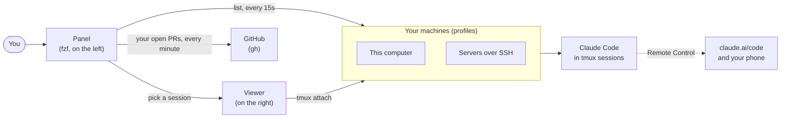

<div align="center">

<pre>
██╗      ███████╗ ██████╗   ██╗    ██████╗   █████╗  ███╗   ██╗ ███████╗ ██╗
██║      ╚══███╔╝ ██╔══██╗ ███║    ██╔══██╗ ██╔══██╗ ████╗  ██║ ██╔════╝ ██║
██║        ███╔╝  ██████╔╝ ╚██║    ██████╔╝ ███████║ ██╔██╗ ██║ █████╗   ██║
██║       ███╔╝   ██╔══██╗  ██║    ██╔═══╝  ██╔══██║ ██║╚██╗██║ ██╔══╝   ██║
███████╗ ███████╗ ██║  ██║  ██║    ██║      ██║  ██║ ██║ ╚████║ ███████╗ ███████╗
╚══════╝ ╚══════╝ ╚═╝  ╚═╝  ╚═╝    ╚═╝      ╚═╝  ╚═╝ ╚═╝  ╚═══╝ ╚══════╝ ╚══════╝
</pre>

**Every Claude Code session you run, on every machine you own, in one clickable list.**<br>
**Your pull requests right under them.**


[Quick start](#-quick-start) ·
[What you get](#-what-you-get) ·
[Using it](#-using-it) ·
[Profiles](#-profiles) ·
[Settings](#-settings) ·
[Something wrong?](#-something-wrong)

</div>

```
┌──────────────────────── lzr1 ────────────────────────┬─ viewer ───────────────────────┐
│ 3 sessions · 1▶ 1⧗ 1·                                │                                │
│ oracle-sessions ssh · online · 2 ─────────────────── │  the session you picked, live: │
│ ▌ ▶ lerian-clients                     opus · 12m ●  │  Claude Code running in tmux   │
│ ▌   Docker dev data export and import                │  on that machine               │
│ ▌   ⎇ feat/docker-dev-data +3 · lerian-clients       │                                │
│   · erebor                            sonnet · 2h    │                                │
│     Review the tmux layer                            │                                │
│     ⎇ main · erebor                                  │                                │
│ macbook-pro-sessions local · online · 1 ──────────── │                                │
│   ⧗ midaz                               opus · 4m    │                                │
│     ⧗ Do you want to run make test?                  │                                │
│     ⎇ feat/fees +7 · midaz                           │                                │
│                                                      │                                │
│                                                      │                                │
│                                                      │                                │
│                                                      │                                │
│                                                      │                                │
│ pull requests victorlazari · gh · 2 ──────────────── │                                │
│   ⧗ #906 fix(oncall): guard ownerless VoIP pro… 2h   │                                │
│     lerian-clients · ⎇ fix/voip-owner · review req…  │                                │
│   ✓ #1398 chore: bump lib-commons               3d   │                                │
│     midaz · ⎇ chore/lib-commons · checks passed      │                                │
│ [+opus] [+sonnet] [↻] [?]                            │                                │
└──────────────────────────────────────────────────────┴────────────────────────────────┘
```

---

## 🚀 Quick start

```sh
git clone https://github.com/victorlazari/lzr1-panel.git ~/Github/lazari/lzr1-panel
cd ~/Github/lazari/lzr1-panel
./install.sh
```

Then open a new terminal and run:

```sh
lzr1-panel open
```

That's it. The installer sets everything up and checks it at the end.
If anything is off, `lzr1-panel doctor` tells you what is wrong and how to fix it.

---

## ✨ What you get

| | |
|---|---|
| 🖥 **All your machines** | This computer and any server over SSH, each one a *profile*. A machine that does not answer is left out until it does. |
| 📋 **Every session, at a glance** | Three lines each: its state (`▶` working, `⧗` waiting on you, `·` idle), name, model and age; what Claude is doing, or the question it is waiting on; its git branch and folder. |
| 🔀 **Your pull requests** | Below the sessions, the open PRs of the GitHub account on this computer, found by itself. `✓` checks passed · `✗` failed or changes requested · `⧗` running or waiting for review · `◌` draft. |
| 👆 **Click to view** | Click a session and the viewer on the right shows it, live. Enter moves your keyboard there. |
| 🖱 **Right-click menus** | On a session: links, copy, rename, end. On a PR: open it, ask Claude to review it or fix its checks, merge. |
| 📱 **Remote Control** | Every session is also on your phone and at claude.ai/code. |
| 🛟 **Sessions survive** | If Claude exits (two Ctrl-Cs, `/exit`, a crash), the session stays. Enter resumes the same conversation. |
| ✂️ **Copy just works** | Drag to select, Ctrl-C, and it's on your clipboard: in any terminal, from any machine. |

---

## 🧭 How it works



- Each **machine** keeps its Claude Code sessions in **tmux**, so they run whether the panel is open or not.
- The **panel** asks every machine for its sessions at once (one shared SSH connection per server), and asks
  GitHub for your open pull requests.
- The **viewer** attaches to the session you pick. Leave it with `Ctrl-b d`, and the session keeps going.

---

## 🎮 Using it

### The panel

| Do this | And this happens |
|---|---|
| **click** a row, or `↑` `↓` | the session shows in the viewer |
| **enter** or double-click | you type in that session (on a PR: it opens in the browser) |
| **right-click**, or `m` | the row's menu |
| `n` / `s`, or `[+opus]` / `[+sonnet]` | a new Opus / Sonnet session (type a name, or click a repository) |
| `t` | the session in a new Ghostty tab |
| `o` | its Remote Control link (on a PR: the PR) |
| `x` | ends the session (asks first) |
| `r`, or `[↻]` | refresh (it also refreshes every 15 seconds) |
| `?` / `q` | all the keys / quit |

### The viewer

- **`Ctrl-b d`** leaves the session (it keeps running).
- **Ctrl-C** goes to Claude, unless text is selected: then it copies.

### The right-click menu

| On a session | On a pull request |
|---|---|
| view it, or view it and type in it | open it, its checks or its files |
| open it in a new Ghostty tab | copy its link or its branch |
| open or copy its Remote Control link | start a session on its repository |
| open its pull request (when its branch has one) | **ask Claude to review it** |
| open its repository on GitHub, or its folder | **ask Claude to fix its failing checks** |
| copy the command that attaches to it | re-run failed checks |
| new session · interrupt Claude · rename | mark it ready for review |
| end it (asks first) | merge or close it (both ask first) |

A machine's heading has a menu too: new sessions there, test the machine, refresh.

### Copying text

> [!TIP]
> In a session: **drag** over the text (Claude highlights it), press **Ctrl-C**, then paste with **Cmd-V**.

- **Cmd-C does not copy inside a session.** Your terminal keeps Cmd-C for its own selection, which is empty while
  Claude has the mouse. Use Ctrl-C.
- **Prefer your terminal's own selection?** Turn mouse reporting off while you select (macOS Terminal: **Cmd-R**;
  Ghostty: hold **Shift**; iTerm2: hold **Option**), then Cmd-C. This also works in the panel.

Not copying? See [Copying text](docs/troubleshooting.md#copying-text).

### From the command line

```sh
lzr1-panel open                             # the panel
lzr1-panel start PROFILE opus|sonnet NAME   # a session, without the panel
lzr1-panel list                             # every session, then your PRs
lzr1-panel prs                              # your open pull requests
lzr1-panel doctor                           # check everything, with fixes
lzr1-panel keys                             # every key
```

Each profile also gets two shortcuts in your shell: `cl-<profile>-opus NAME` and `cl-<profile>-sonnet NAME`.

---

## 🗂 Profiles

A profile is a machine. Add one by answering a few questions:

```sh
lzr1-panel profile add
```

Or in one line:

```sh
lzr1-panel profile add my-mac --local --repos ~/Github/lerian
lzr1-panel profile add my-server --ssh user@host --key ~/.ssh/my.key --repos '~/repos'
```

Or just ask Claude: *"create a new lzr1-panel profile"* ([the guide it follows](docs/profiles.md)).

| Command | What it does |
|---|---|
| `lzr1-panel profile list` | your profiles |
| `lzr1-panel profile test NAME` | reaches it and checks tmux, Claude and the folders |
| `lzr1-panel profile show NAME` | what it holds |
| `lzr1-panel profile remove NAME` | removes it |

A session named like a folder in `--repos` opens inside it: `lerian-clients` opens in `~/Github/lerian/lerian-clients`.

> [!IMPORTANT]
> **Profiles stay private.** They live in `~/.config/lzr1-panel/profiles/`, never in this repository: they hold
> hosts and key paths.

An SSH machine needs **tmux** and **Claude Code** (signed in) installed there. `lzr1-panel profile test NAME` tells
you if something is missing.

---

## 📦 What the installer does

`./install.sh` works on macOS and Linux, and is safe to run again: it only changes what is missing.

1. **Tools**: zsh, tmux, fzf 0.74+, curl, openssl, git, gh and jq.
2. **Claude Code**, and **Ghostty** on macOS (it asks first).
3. **Copying**: Ctrl-C copies a Shift-selection in Ghostty (it asks first).
4. **The `lzr1-panel` command**, in `~/.local/bin`.
5. **The Claude Code skill** that creates profiles.
6. **A shell hook**: the `cl-*` shortcuts and, if you want, the panel opening with Ghostty.
7. **GitHub sign-in** (`gh auth login`), so the panel lists your pull requests.
8. **Your first profile**.
9. **`lzr1-panel doctor`**, to check it all.

| Option | What it does |
|---|---|
| `./install.sh --yes` | answers yes to everything |
| `./install.sh --no-shell` | leaves your shell files alone |
| `./install.sh --uninstall` | removes it all (your profiles stay) |

---

## ⚙ Settings

Set these in your shell, for example in `~/.zshenv`:

| Setting | Default | What it does |
|---|---|---|
| `LZR1_PANEL_WIDTH` | `56` | the panel's width, in columns |
| `LZR1_MENU_BUTTON` | `right` | `left` opens menus with the left button |
| `LZR1_PRS` | `1` | `0` hides the pull requests |
| `LZR1_SPLASH` | `1` | `0` skips the opening animation |
| `LZR1_SPLASH_SECONDS` | `5` | how long the animation lasts |
| `LZR1_PANEL` | `1` | `0` stops the panel opening with Ghostty |
| `LZR1_CONFIG` | `~/.config/lzr1-panel` | where your profiles live |

---

## 🛟 Something wrong?

Run this first:

```sh
lzr1-panel doctor
```

Then see **[docs/troubleshooting.md](docs/troubleshooting.md)**: every common problem, and how to fix it.

---

## 🧱 Inside the repository

```
bin/lzr1-panel                  the command: panel, viewer, sessions, PRs, menus, profiles
lib/splash.zsh                  the opening animation
install.sh                      the installer, for macOS and Linux
docs/troubleshooting.md         problems and their fixes
docs/profiles.md                how to create a profile (for people and AI assistants)
docs/*-options.html             the designs considered: splash, sidebar, PR section, menus
skills/lzr1-panel-profiles/     the Claude Code skill that creates profiles
AGENTS.md                       pointers for AI assistants working here
```

## 🤝 Contributing

Changes are welcome. Before opening a pull request, check the scripts parse:

```sh
zsh -n bin/lzr1-panel lib/splash.zsh
bash -n install.sh          # it must also run on macOS's bash 3.2
```

Scripts sent to a profile's machine run as POSIX `sh`. [AGENTS.md](AGENTS.md) has the rest.

<div align="center">
<sub>Made for people who run Claude Code everywhere.</sub>
</div>
